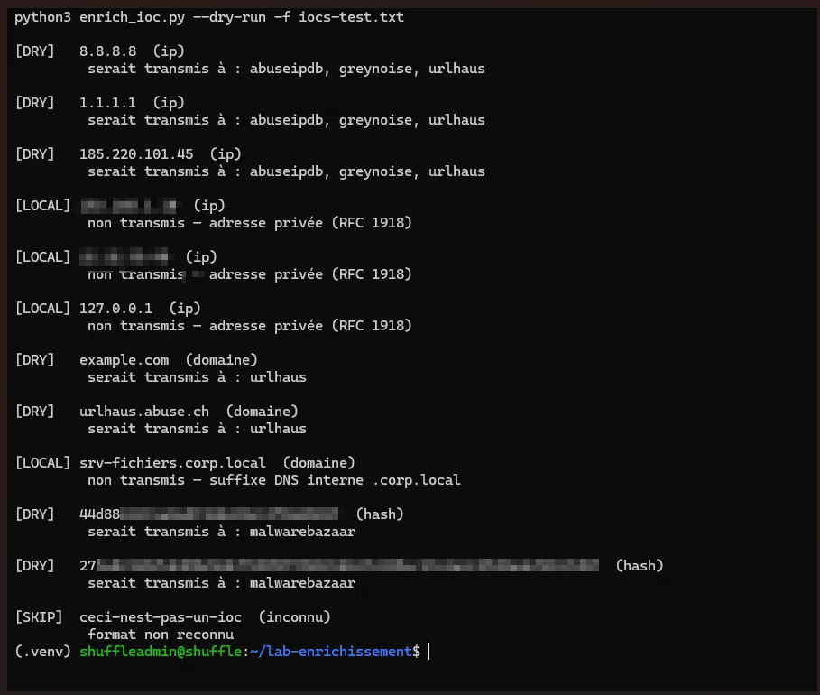
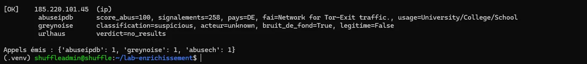
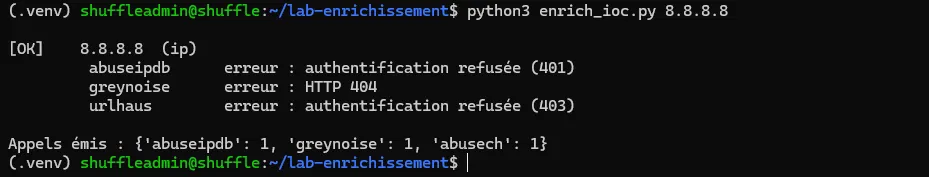
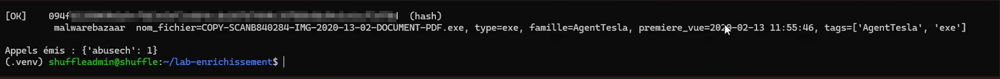
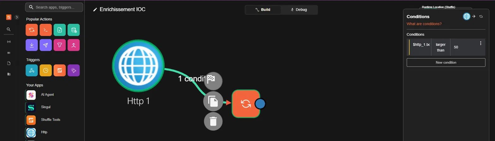
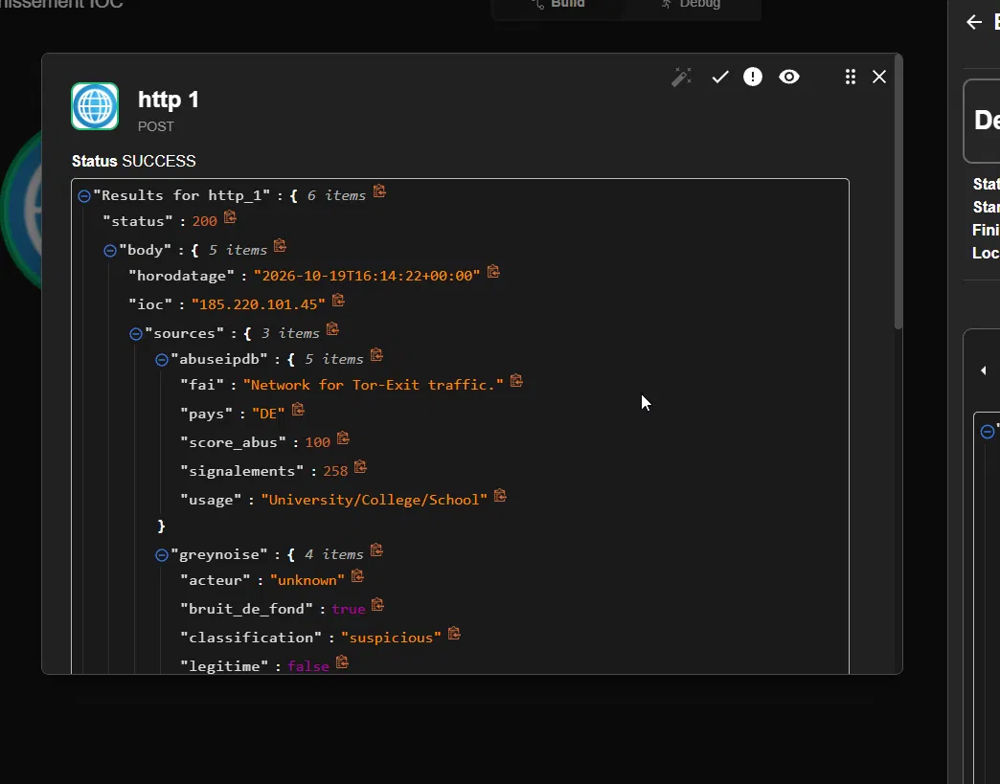
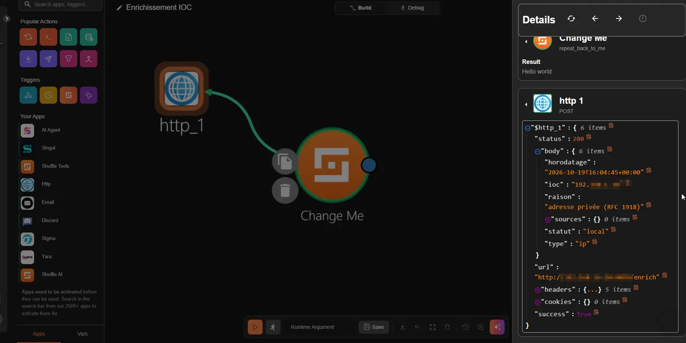

# Enrichissement d'IOC & Réponse automatisée (SOAR)

> Projet SOAR — enrichir automatiquement les indicateurs de compromission via la Threat
> Intelligence, puis déclencher une réponse conditionnelle. Avec un principe central :
> **ne jamais transmettre un indicateur interne à un service tiers.**

**Catégorie :** Security Orchestration, Automation & Response (SOAR)
**Outils :** Shuffle · Python · Flask · AbuseIPDB · GreyNoise · abuse.ch (URLhaus / MalwareBazaar)

---

## 1. Résumé

Ce projet automatise l'**enrichissement d'indicateurs de compromission** (IP, domaines, hashs)
à partir de plusieurs sources de Threat Intelligence, puis intègre cet enrichissement dans un
workflow SOAR qui **décide** d'alerter ou non selon le niveau de menace.

Le point de conception qui structure tout le projet : **un filtre de périmètre** écarte les
indicateurs internes (IP privées, domaines `.corp.local`) **avant** tout appel réseau. Un SOC ne
doit jamais divulguer sa cartographie interne à un service externe — c'est une exigence de
confidentialité, pas une option.

**Compétences mises en œuvre :** scripting Python, consommation d'API REST, gestion des erreurs
et des quotas, Threat Intelligence, orchestration SOAR, raisonnement sur la protection des données.

---

## 2. Architecture

```
          ┌─────────────────────────────────────────────┐
          │  Filtre de périmètre (avant tout appel)      │
IOC  ───► │  IP privée / domaine interne  → NON transmis │
          │  IP publique / domaine / hash → enrichi      │
          └──────────────────┬──────────────────────────┘
                             │
         ┌───────────────────┼───────────────────┐
         ▼                   ▼                   ▼
    AbuseIPDB            GreyNoise           abuse.ch
 (réputation IP)   (scan de masse ?)   (URLhaus / MalwareBazaar)
         │                   │                   │
         └───────────────────┼───────────────────┘
                             ▼
                    API Flask locale (token)
                             ▼
                    Workflow Shuffle (SOAR)
                             ▼
              score > 50 ? ──► notification : ignore
```

| Source | Ce qu'elle apporte |
|--------|--------------------|
| **AbuseIPDB** | Score de réputation communautaire d'une IP (0 = propre, 100 = massivement signalée) |
| **GreyNoise** | Distingue le **scan de masse Internet** (bruit de fond) d'une activité ciblée |
| **abuse.ch** | URLhaus (URLs malveillantes) et MalwareBazaar (hashs de malware connus) |

---

## 3. Le principe clé : filtrer avant d'interroger

Avant tout appel externe, le script classe chaque indicateur. Les adresses privées (RFC 1918)
et les domaines internes ne quittent **jamais** le périmètre.



On lit clairement le comportement :
- `[DRY]` IP publiques (`8.8.8.8`, `185.220.101.45`) → **seraient transmises** aux sources.
- `[LOCAL]` IP privées (`192.168.X.X`, `10.X.X.X`) et domaine `.corp.local` → **non transmis**.
- `[SKIP]` saisie invalide → ignorée proprement.

> **Pourquoi c'est le point le plus important :** envoyer une IP interne à AbuseIPDB, c'est révéler
> un morceau de sa cartographie réseau à un tiers. Ce filtre, placé **avant** le premier appel,
> est ce qui rend l'outil utilisable dans un contexte professionnel.

---

## 4. Enrichissement en conditions réelles

### 4.1 Cas d'une IP malveillante

Test sur `185.220.101.45` (nœud de sortie Tor connu) :



- **AbuseIPDB** : `score_abus=100`, 258 signalements → réputation très mauvaise.
- **GreyNoise** : `classification=suspicious`, `legitime=False` → activité douteuse.

### 4.2 Cas d'une IP propre

Test sur `8.8.8.8` (DNS public Google) :



- **AbuseIPDB** : `score_abus=0`, usage « Content Delivery Network » → légitime.
- **GreyNoise** : `non observée` → aucune activité suspecte.

Le contraste entre ces deux cas est exactement ce qui permet à un analyste de **qualifier** une
alerte : la même requête, deux verdicts opposés.

### 4.3 Cas d'un hash de malware

L'enrichissement couvre aussi les hashs via MalwareBazaar :



Le hash est identifié comme appartenant à la famille **AgentTesla** (un infostealer), avec son
nom de fichier d'origine et sa date de première observation.

---

## 5. Intégration SOAR (Shuffle)

Le script est exposé via une **API Flask locale** (sécurisée par token), que Shuffle appelle
comme n'importe quel service. Le workflow enrichit l'IOC reçu, puis **décide** d'alerter.



La **condition** posée sur la liaison : le nœud de notification ne s'exécute **que si**
`score_abus > 50`. En dessous, le workflow s'arrête silencieusement — l'IOC a été vérifié, rien
ne justifie d'alerter. C'est le basculement d'un workflow qui *exécute* vers un workflow qui
*décide*.

### 5.1 Vérification : l'enrichissement remonte bien dans Shuffle



Le JSON retourné par l'API est bien parsé par Shuffle : `abuseipdb.score_abus = 100`,
`greynoise.classification = suspicious`. La chaîne complète API → SOAR fonctionne.

### 5.2 Vérification : le filtre fonctionne aussi dans le workflow



Lorsqu'un IOC interne (`192.168.X.X`) traverse le workflow, il revient avec `statut: local` et
`sources: {}` (vide) : **aucune donnée interne n'a été transmise**. Le principe de périmètre est
respecté de bout en bout, pas seulement dans le script.

---

## 6. Limites en production (analyse)

Un point souvent oublié : un enrichissement **absent** ne signifie **jamais** « IOC propre ».

- **Confidentialité** : certaines sources enregistrent les requêtes. Toute intégration sur des
  données réelles doit être validée par la filière sécurité.
- **Quotas** : les tiers gratuits n'ont pas de SLA. Un workflow SOAR doit **dégrader proprement**
  si une API est indisponible, pas planter.
- **Fiabilité** : les scores communautaires (AbuseIPDB) ne sont pas vérifiés ; une IP « bénigne »
  aujourd'hui peut être compromise demain. Ces sources **orientent** une décision humaine, elles
  ne font pas autorité.
- **Cadre légal** : CGU (usage commercial parfois interdit), localisation et durée de conservation
  des données à vérifier avant tout branchement en production.

---

## 7. Ce que ce projet démontre

- **Orchestration SOAR** de bout en bout : de l'IOC reçu à la réponse conditionnelle.
- **Consommation d'API REST** avec gestion propre des erreurs et des quotas.
- Connaissance des **sources de Threat Intelligence** et de ce que chacune apporte réellement.
- **Scripting Python** et exposition via une API (réutilisable par d'autres outils).
- Et surtout : un **raisonnement sur la protection des données de l'entreprise**, matérialisé par
  un filtre de périmètre appliqué avant tout appel externe.
